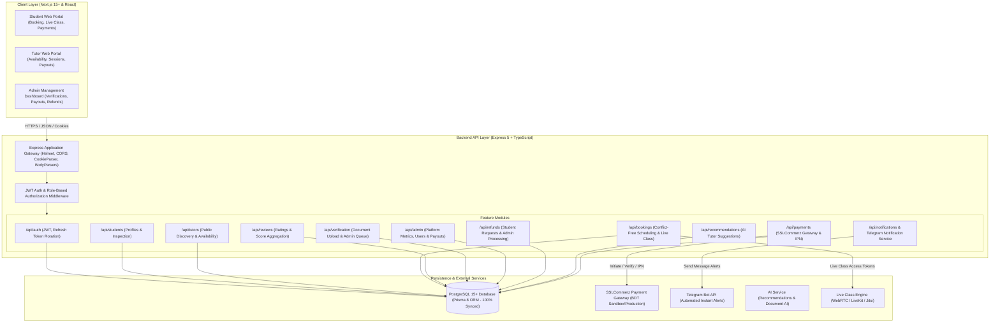

# TutorLink System Architecture & Implementation Blueprint

**Platform:** TutorLink - AI-Powered Tutor Booking Platform with Live Classes and Smart Notifications  
**Target Market:** Bangladesh (BDT currency, Asia/Dhaka timezone, SSLCommerz, bKash / Nagad / Rocket payouts)  
**Date:** November 18, 2026  
**Status:** **Backend 100% Implemented, Migrated & Verified**  
**Document Target:** `architecture.md`  

---

## 1. Executive Summary & Vision

**TutorLink** is an AI-powered tutor booking and online learning platform designed to bridge the gap between students and qualified tutors in Bangladesh. The platform unifies tutor discovery, AI-assisted recommendations, automated scheduling, secure localized payments (SSLCommerz), integrated live video classrooms, document verification with AI assessment, automated Telegram notifications, and a transparent 10% platform commission payout model.

### Key Actors & User Roles
1. **Students**: Discover tutors, receive AI recommendations, schedule sessions, make payments in BDT, attend live video classes, view booking/payment history, request refunds for cancellations, and post reviews.
2. **Tutors**: Manage qualifications, set recurring availability, accept/reject booking requests, conduct live tutoring sessions, track earnings, and receive payouts via bKash, Nagad, or Rocket.
3. **Administrators**: Review and verify student/tutor credentials (NID, certificates), oversee bookings and financial transactions, approve and process tutor payouts, manage refunds, and administer users.

---

## 2. End-to-End System Architecture



---

## 3. Technology Stack Specification

| Component | Selected Technology | Status | Details / Role |
| :--- | :--- | :--- | :--- |
| **Backend Framework** | Node.js, Express.js `^5.2.1` | **Operational** | Modular REST API service in TypeScript `^6.0.3` |
| **Database & ORM** | PostgreSQL 15+, Prisma ORM 8 | **100% Synced** | Migrations executed; `db:verify` passed |
| **Authentication** | JWT (`jsonwebtoken`), `bcrypt` | **Operational** | 15-minute access token + SHA-256 hashed DB refresh tokens with rotation & reuse detection |
| **Input Validation** | Zod `^4.6.7` | **Operational** | Runtime schema parsing with field-level error output |
| **Payment Gateway** | SSLCOMMERZ | **Operational** | Local Bangladesh payment rails with server-to-server validation & IPN webhooks |
| **Commission & Payout** | Direct MFS Disbursement | **Operational** | 10% platform commission fee deduction model; bKash, Nagad, Rocket disbursement tracking |
| **Notification Engine**| Telegram Bot API | **Operational** | Webhook/HTTP delivery for booking, payment, and reminder events |
| **Live Classes** | WebRTC Signaling (ws) | **✅ Fully Operational** | WebSocket signaling server + JWT room tokens for 1:1 peer-to-peer video |
| **AI Recommendation** | Scoring & Compatibility Engine | **Operational** | Student-tutor semantic matching on ratings, experience, location, and history |
| **Document Verification**| Multi-document Submission | **Operational** | NID, Student ID, Certificate submission with admin approval queue |
| **Frontend Client** | Next.js, React, Tailwind CSS | **Pending** | Target UI in `client/` using `shadcn/ui` components |

---

## 4. Completed Backend Feature Matrix

### 1. Authentication & User Management (`/api/auth`)
* `POST /register`: Registers `STUDENT` or `TUTOR` accounts with bcrypt 12-round hashing.
* `POST /login`: Issues short-lived access token and httpOnly refresh token cookie.
* `POST /refresh`: Strict token family rotation with automated reuse detection and revocation.
* `POST /logout`: Revokes token in PostgreSQL and clears cookies.
* `GET /me`: Returns authenticated session details.

### 2. Public Tutor Discovery (`/api/tutors`)
* `GET /`: Search and filter tutors by keyword, subject, hourly rate, rating, and location with pagination.
* `GET /:tutorId`: Public tutor details with qualifications, bio, and student reviews.
* `GET /:tutorId/availability`: Public view of weekly recurring availability windows.
* `GET /me`, `PATCH /me`: Tutor self-management of profile, bio, subjects, rate, and payout account.
* `GET /me/payouts`: Tutor earnings breakdown and payout status.
* `POST/GET/PUT/DELETE /availability`: Recurring weekly schedule management with overlap protection.

### 3. Student Profile & Inspection (`/api/students`)
* `GET /me`, `PATCH /me`: Student profile management.
* `GET /:studentId`: Profile inspection endpoint for tutors and admins.

### 4. Booking Lifecycle & Live Classes (`/api/bookings`)
* `POST /`: Student books tutor with Asia/Dhaka time bounds, availability window check, and conflict protection.
* `GET /`: Filterable and paginated user bookings list.
* `GET /:id`: Specific booking details with participation authorization.
* `PATCH /:id/respond`: Tutor confirms or rejects request.
* `PATCH /:id/cancel`: Cancellation with mandatory reason.
* `PATCH /:id/complete`: Tutor completes booking after lesson end; calculates 10% commission and creates `TutorPayout` record.
* `GET /:id/live-class`: Shorthand — delegates to live-class service, returns signed room token + WebSocket URL.

### 4b. WebRTC Live Class System (`/api/live-classes` + `ws://…/ws/live-class`)

The signaling system uses a custom WebSocket server (`ws` package) attached to the same HTTP server via the `upgrade` event.

**REST endpoint:**
* `GET /api/live-classes/:bookingId/token` — Validates booking status (`CONFIRMED`), checks participant membership, enforces time-window (opens 10 min early, closes at `endAt`), and returns a signed JWT room token + full WebSocket URL.

**WebSocket signaling (`ws://host/ws/live-class?token=<JWT>`):**
* Token validated at upgrade time (HTTP 401 on failure — no WebSocket connection established).
* Rooms keyed by `tutorlink-room-<bookingId>` with max 2 canonical peers (`student` + `tutor`); `admin` joins as observer.
* Supported client→server message types: `offer`, `answer`, `ice-candidate`, `leave`, `ping`.
* Server→client events: `peer-joined`, `peer-left`, `offer`, `answer`, `ice-candidate`, `error`, `pong`.
* Dead connections replaced automatically on role re-entry.
* Room diagnostics: `GET /api/health/live-classes`.

**Client protocol (abbreviated):**
```jsonc
// Connect: ws://localhost:5000/ws/live-class?token=<room_token>
// Send offer:
{ "type": "offer", "payload": { "type": "offer", "sdp": "..." } }
// Server relays to other peer — same for "answer" and "ice-candidate"
// Keep-alive:
{ "type": "ping" }  // → server replies { "type": "pong" }
```

### 5. Payments & Commission (`/api/payments`)
* `POST /`: Initiates SSLCommerz checkout session with student contact info.
* `GET /`, `GET /:id`: Student payment history and details.
* `POST /sslcommerz/success`: Gateway redirect verification against SSLCommerz validation API.
* `POST /sslcommerz/fail`, `POST /sslcommerz/cancel`: Gateway state recording.
* `POST /sslcommerz/ipn`: Instant Payment Notification server-to-server webhook.

### 6. Refunds Management (`/api/refunds`)
* `POST /`: Student requests refund for cancelled booking payment.
* `GET /my-refunds`: Student refund history.
* `GET /admin/all`: Admin refund request review queue.
* `PATCH /admin/:id`: Admin processes refund (marks `SUCCEEDED` / `FAILED` and sets payment to `REFUNDED`).

### 7. Document Verification (`/api/verification`)
* `POST /submit`: Student/Tutor uploads NID, Student ID, or certificates.
* `GET /my-requests`: Current user's submission status and AI assessment results.
* `GET /admin/requests`: Admin review queue.
* `PATCH /admin/requests/:id`: Admin approves/rejects request. Approving automatically sets `isVerified = true` on the tutor profile.

### 8. Reviews & Ratings (`/api/reviews`)
* `POST /`: Student submits 1-to-5 star rating and review after session completion.
* Automatically recalculates `averageRating` and `totalReviews` on `TutorProfile`.
* `GET /tutors/:tutorId`: Public reviews list for any tutor.

### 9. Smart Telegram Notifications (`/api/notifications`)
* `POST /telegram/link`: Connects user's Telegram Chat ID and sends a confirmation test message.
* Instant Markdown Telegram alerts dispatched on booking creation, acceptance/rejection, and payment completion.
* In-app notification center: `GET /`, `GET /unread-count`, and `PATCH /:id/read`.

### 10. AI Tutor Recommendations (`/api/recommendations`)
* `GET /tutors`: Intelligent tutor suggestions based on rating, location proximity, experience, verified status, and previous booking history.

### 11. Admin Operations (`/api/admin`)
* `GET /analytics`: Real-time GMV, 10% platform commission revenue, total bookings, active users, and pending action items.
* `GET /users`: Platform user directory with role and status filters.
* `PATCH /users/:id/status`: Account activation/deactivation.
* `GET /payouts`: Pending tutor earnings queue.
* `PATCH /payouts/:id/disburse`: Records payout disbursement with MFS transaction reference (bKash/Nagad/Rocket).

---

## 5. Seeded Test Accounts

The database is pre-seeded with sample accounts for testing:

| Role | Email | Password | Details |
| :--- | :--- | :--- | :--- |
| **Admin** | `admin@tutorlink.com` | `Admin@123456` | Platform Administrator |
| **Tutor** | `tutor@tutorlink.com` | `Tutor@123456` | Dr. Tanvir Ahmed (BUET M.Sc, Verified, ৳600/hr, bKash) |
| **Student** | `student@tutorlink.com` | `Student@123456` | Nafis Rahman (Notre Dame College, HSC) |
