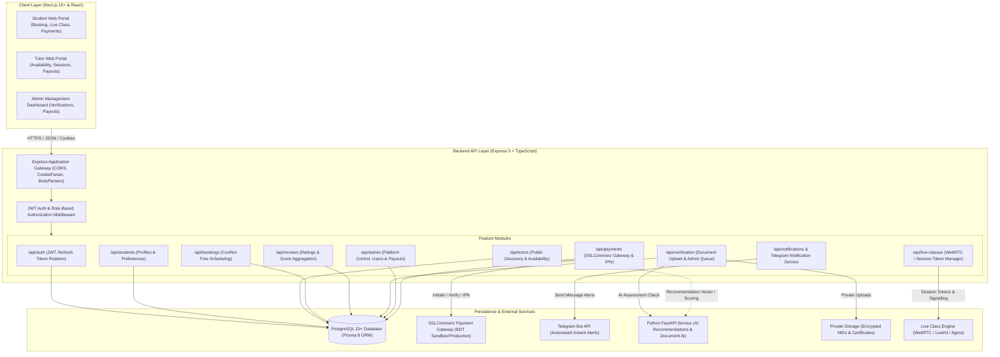
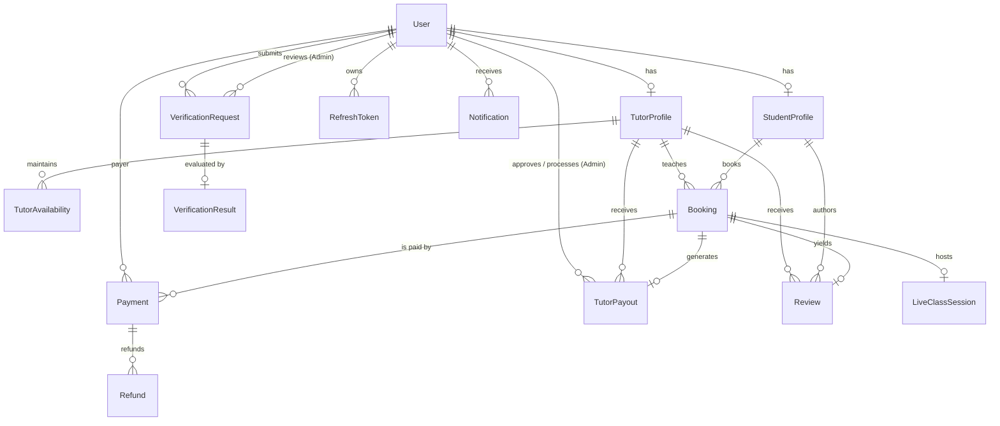
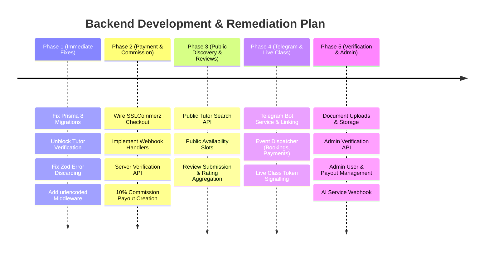

# TutorLink System Architecture & Implementation Blueprint

**Platform:** TutorLink - AI-Powered Tutor Booking Platform with Live Classes and Smart Notifications  
**Target Market:** Bangladesh (BDT currency, Asia/Dhaka timezone, SSLCommerz, bKash / Nagad / Rocket payouts)  
**Date:** November 18, 2026  
**Document Target:** `architecture.md`  

---

## 1. Executive Summary & Vision

**TutorLink** is an AI-powered tutor booking and online learning platform designed to bridge the gap between students and qualified tutors. The platform unifies tutor discovery, AI-assisted recommendations, automated scheduling, secure localized payments (SSLCommerz), integrated live video classrooms (WebRTC/external provider), document verification with AI assessment, automated Telegram notifications, and a transparent 10% platform commission payout model.

### Key Actors & User Roles
1. **Students**: Discover tutors, receive AI recommendations, schedule sessions, make payments in BDT, attend live video classes, view booking/payment history, and post reviews.
2. **Tutors**: Manage qualifications, set recurring availability, accept/reject booking requests, conduct live tutoring sessions, track earnings, and receive payouts via bKash, Nagad, or Rocket.
3. **Administrators**: Review and verify student/tutor credentials (NID, certificates), oversee bookings and financial transactions, approve and process tutor payouts, and administer users.

---

## 2. End-to-End System Architecture



---

## 3. Technology Stack Specification

| Component | Selected Technology | Details / Role |
| :--- | :--- | :--- |
| **Frontend** | Next.js, React, Tailwind CSS | UI with `shadcn/ui` components & `lucide-react` icons (Planned in `client/`) |
| **Backend Framework** | Node.js, Express.js `^5.2.1` | Modular REST API service in TypeScript `^6.0.3` |
| **Database & ORM** | PostgreSQL 15+, Prisma ORM 8 | `@prisma/orm-postgres ^8.0.0-rc.23`, `prisma ^8.0.0-rc.33` with data contracts |
| **Authentication** | JWT (`jsonwebtoken`), `bcrypt` | 15-minute access token + SHA-256 hashed DB refresh tokens with rotation & reuse detection |
| **Input Validation** | Zod `^4.6.7` | Strict runtime schema parsing across all endpoints |
| **Payment Gateway** | SSLCOMMERZ | Local Bangladesh payment rails (Cards, Mobile Banking: bKash, Nagad, Rocket, Net Banking) |
| **Payout System** | Direct MFS Disbursement | 10% platform commission fee deduction model; bKash, Nagad, Rocket tracking |
| **Notification Engine**| Telegram Bot API | Webhook/HTTP delivery for booking, payment, reminder, and system events |
| **Live Classes** | WebRTC / External Media Provider | In-browser audio/video, scheduled access validation, dynamic room tokens |
| **AI Recommendation** | Python, FastAPI | Microservice for student-tutor semantic matching and resume/NID assessment |
| **Document Storage** | Private S3-compatible Object Storage | Secure pre-signed upload URLs for NID, student ID, and certificates |

---

## 4. Database Schema & Domain Entity Models

The application's data layer is defined in `server/src/prisma/contract.prisma`.



### Detailed Entity Overview

1. **`User`**:
   - Fields: `id`, `email`, `username`, `passwordHash`, `name`, `phone`, `role` (`STUDENT`, `TUTOR`, `ADMIN`), `telegramChatId`, `telegramUsername`, `isActive`, `createdAt`, `updatedAt`.
2. **`RefreshToken`**:
   - Fields: `id`, `userId`, `tokenHash`, `familyId`, `expiresAt`, `revokedAt`, `createdAt`.
   - Enables secure multi-device refresh token rotation with automated reuse revocation.
3. **`StudentProfile`**:
   - Fields: `id`, `userId`, `institution`, `department`, `educationLevel`, `location`, `profileImage`, `preferredSubjects`, `createdAt`, `updatedAt`.
4. **`TutorProfile`**:
   - Fields: `id`, `userId`, `qualification`, `institution`, `department`, `experienceYears`, `bio`, `subjects`, `hourlyRate`, `location`, `profileImage`, `accountNumber`, `payoutMethod` (`BKASH`, `NAGAD`, `ROCKET`), `isVerified`, `averageRating`, `totalReviews`, `createdAt`, `updatedAt`.
5. **`TutorAvailability`**:
   - Fields: `id`, `tutorProfileId`, `dayOfWeek` (0=Sun..6=Sat), `startTime` ("HH:mm"), `endTime` ("HH:mm"), `isAvailable`, `createdAt`, `updatedAt`.
6. **`Booking`**:
   - Fields: `id`, `studentId`, `tutorId`, `startAt`, `endAt`, `durationMin`, `hourlyRate`, `totalAmount`, `status` (`PENDING`, `CONFIRMED`, `COMPLETED`, `CANCELLED`, `REJECTED`), `studentMessage`, `tutorMessage`, `cancellationReason`, `liveClassRoomId`, `createdAt`, `updatedAt`.
7. **`LiveClassSession`** *(Extension for Section 3.6)*:
   - Fields: `id`, `bookingId`, `roomToken`, `tutorJoinedAt`, `studentJoinedAt`, `endedAt`, `durationSeconds`.
8. **`Payment`**:
   - Fields: `id`, `bookingId`, `payerId`, `amount`, `currency` ("BDT"), `paymentMethod`, `paymentProvider` ("SSLCOMMERZ"), `transactionId`, `providerSessionId`, `idempotencyKey`, `checkoutUrl`, `status` (`PENDING`, `SUCCEEDED`, `FAILED`, `CANCELLED`, `PARTIALLY_REFUNDED`, `REFUNDED`), `paidAt`, `failureReason`, `createdAt`, `updatedAt`.
9. **`TutorPayout`**:
   - Fields: `id`, `bookingId`, `tutorProfileId`, `grossAmount`, `commissionRate` (0.10), `commissionAmount`, `netAmount`, `currency` ("BDT"), `payoutMethod`, `payoutAccountNumber`, `status` (`PENDING`, `APPROVED`, `PROCESSING`, `PAID`, `FAILED`, `REJECTED`, `CANCELLED`), `approvedById`, `paidById`, `transferReference`, `adminNote`, `approvedAt`, `paidAt`, `createdAt`, `updatedAt`.
10. **`Review`**:
    - Fields: `id`, `bookingId`, `tutorId`, `studentId`, `rating` (1-5), `comment`, `createdAt`, `updatedAt`.
11. **`VerificationRequest`**:
    - Fields: `id`, `userId`, `documentType` ("NID", "STUDENT_ID", "CERTIFICATE"), `fileObjectKey`, `status` (`PENDING`, `APPROVED`, `REJECTED`, `RESUBMISSION_REQUIRED`), `adminNote`, `reviewedAt`, `reviewedById`, `createdAt`, `updatedAt`.
12. **`VerificationResult`**:
    - Fields: `id`, `verificationRequestId`, `assessment` (`LIKELY_VALID`, `LIKELY_INVALID`, `UNCERTAIN`), `confidence`, `explanation`, `modelVersion`, `createdAt`.
13. **`Notification`**:
    - Fields: `id`, `userId`, `type` (`BOOKING_UPDATE`, `PAYMENT_UPDATE`, `VERIFICATION_UPDATE`, `CLASS_REMINDER`, `SYSTEM`), `title`, `message`, `isRead`, `readAt`, `sentToTelegram`, `createdAt`.
14. **`Refund`**:
    - Fields: `id`, `paymentId`, `amount`, `reason`, `status` (`PENDING`, `SUCCEEDED`, `FAILED`), `providerRefundId`, `processedAt`, `createdAt`, `updatedAt`.

---

## 5. Detailed Status Audit: Finished vs. Broken vs. Missing

### 5.1 What Is Finished (Implemented & Operational)

| Module / Component | Endpoints / Features | Status |
| :--- | :--- | :--- |
| **Authentication** | `POST /api/auth/register`<br>`POST /api/auth/login`<br>`POST /api/auth/refresh`<br>`POST /api/auth/logout`<br>`GET /api/auth/me` | **Fully functional**. Bcrypt hashing (12 rounds), JWT access token (15m), secure httpOnly cookies, token-family DB rotation with automated reuse detection and revocation. |
| **Student Profile** | `GET /api/students/me`<br>`PATCH /api/students/me` | **Functional**. Fetch and partial update for student educational data and location. |
| **Tutor Profile** | `GET /api/tutors/me`<br>`PATCH /api/tutors/me` | **Functional**. Self-management of qualifications, bio, hourly rate, subjects, and payout account. |
| **Tutor Availability** | `POST /api/tutors/availability`<br>`GET /api/tutors/availability`<br>`PUT /api/tutors/availability/:id`<br>`DELETE /api/tutors/availability/:id` | **Functional**. Weekly slot creation with strict day-of-week validation, time formatting, and overlap protection. |
| **Booking Core Logic**| `POST /api/bookings`<br>`GET /api/bookings`<br>`GET /api/bookings/:id`<br>`PATCH /api/bookings/:id/respond`<br>`PATCH /api/bookings/:id/cancel`<br>`PATCH /api/bookings/:id/complete` | **Partially functional**. Implements full booking state transitions, Asia/Dhaka day boundaries, duration and rate calculation. (Blocked by verification check; see Broken below). |
| **Health Checks** | `GET /`<br>`GET /api/health`<br>`GET /api/health/db` | **Functional**. Basic liveness and PostgreSQL live connection ping. |
| **Core Utilities** | `ApiError`, `ApiResponse`, `catchAsync`, `datetime.ts` (Asia/Dhaka Intl formatter), `token.ts` | **Functional**. Consistent response wrappers, error propagation, and timezone calculations. |

---

### 5.2 What Is Broken (Bugs, Blockers & Gaps)

1. **Critical Database Schema Out-of-Sync (Prisma 8 Mismatch)**:
   - Changes in `contract.prisma` (adding `payoutMethod` on `TutorProfile`, new `Payment` fields, and the `TutorPayout` table) were never executed as a PostgreSQL migration.
   - **Runtime Error**: `column tutor_profiles.payoutMethod does not exist`, `relation "public.tutor_payouts" does not exist`.
   - **Impact**: All tutor profile reads, availability writes, payments, and booking requests throw 500 database errors at runtime. `npm run db:verify` fails.
2. **Tutor Verification Deadlock**:
   - `booking.service.ts` line 30 enforces:
     ```typescript
     if (!tutor.isVerified) throw new ApiError(403, "This tutor is not verified");
     ```
   - `TutorProfile.isVerified` defaults to `false`.
   - Because `server/src/modules/verification/` is completely empty and no admin approval API exists, **no tutor can ever become verified**, blocking all bookings in the system.
3. **Disconnected & Incomplete SSLCommerz Integration**:
   - `sslcommerz.service.ts` exists, but `payment.service.ts` never calls it.
   - `POST /api/payments` creates a dummy `PENDING` record without a transaction ID or gateway checkout URL.
   - Checkout fields (`phone`, `address`, `city`, `postcode`) are validated by Zod but dropped by the controller.
   - There are **no callback or webhook routes** (`/api/payments/sslcommerz/success`, `/fail`, `/cancel`, `/ipn`).
   - SSLCommerz posts form data (`application/x-www-form-urlencoded`), but `server/src/app.ts` only mounts `express.json()`, causing incoming webhooks to fail parsing.
   - No payment server-to-server validation check (`validator/api/validationserverAPI.php`) is implemented to prevent transaction forgery.
4. **Zod Validation Error Details Swallowed**:
   - Controllers discard `parsed.error.flatten()` and throw generic messages like `new ApiError(400, "Invalid payment data")`, leaving clients with no field-specific guidance.
5. **In-Memory Filtering & Concurrency Flaws**:
   - `createBooking` loads all of a tutor's historical bookings into Node.js memory to test overlaps, with no database-level locking or transaction.
   - `getMyBookings` loads all user records into memory and slices/sorts in JavaScript instead of SQL `LIMIT`/`OFFSET`.
6. **Financial Disconnect in Booking Lifecycle**:
   - Cancelling a confirmed booking does not check payment status or initiate a refund.
   - Completing a booking does not verify payment status and does not generate a `TutorPayout` record with the required 10% platform commission calculation.
7. **Import & Typo Inconsistencies**:
   - `booking.controller.ts` dynamically imports `../../prisma/db.js` with `.js` extension instead of static `../../prisma/db`.
   - `server/src/modules/auth/auth.typs.ts` has a spelling typo.
   - `helmet` and `morgan` are installed in `package.json` but never imported in `app.ts`.
   - `server/.env.example` only lists `DATABASE_URL` and is missing all JWT and SSLCommerz environment variables.

---

### 5.3 What Is Missing (Required Project Specifications)

#### 1. Frontend Web Client (`client/`)
- Completely empty directory (0 files). Requires a Next.js 15+ App Router application with React, `shadcn/ui`, and `lucide-react`.

#### 2. Public Tutor Discovery & Exploration APIs
- All routes in `/api/tutors` currently require `authenticate` and `authorize("TUTOR")`. Students and visitors have no way to view tutors.
- **Missing Endpoints**:
  - `GET /api/tutors`: Public tutor listing with pagination and filters (subject, min/max hourlyRate, location, minimum rating, search query).
  - `GET /api/tutors/:tutorId`: Public tutor profile with qualifications, bio, and review statistics.
  - `GET /api/tutors/:tutorId/availability`: Public availability calendar slots so students know when a tutor is bookable.
  - `GET /api/students/:studentId`: Allows tutors to inspect the profile of a student who sent a booking request.

#### 3. AI-Based Tutor Recommendation System (Section 3.4)
- Python FastAPI microservice integration or internal scoring engine.
- Recommendation algorithm taking into account:
  - Student preferred subjects and education level.
  - Tutor hourly rate vs student budget.
  - Location proximity (e.g. Dhaka divisions/districts).
  - Tutor average ratings and review count.
  - Past booking history.
- Endpoint: `GET /api/recommendations/tutors`.

#### 4. Live Class System (Section 3.6)
- WebRTC signalling or integration with an external video provider (e.g., LiveKit, Daily.co, Agora, or Jitsi Meet).
- Endpoints:
  - `GET /api/bookings/:id/live-class/token`: Generate secure, signed access tokens for confirmed, paid bookings.
  - `POST /api/bookings/:id/live-class/end`: Log class completion time and duration.
- Access control: Restrict entry strictly to the authorized student and tutor during the scheduled time window.

#### 5. Smart Telegram Notification System (Section 3.8)
- Telegram Bot integration via Telegram Bot API (`https://api.telegram.org/bot<TOKEN>/sendMessage`).
- User account linking: `telegramChatId` generation and verification via Telegram deep link (`https://t.me/<bot_username>?start=<user_link_token>`).
- Automated notification triggers:
  - *New booking request* -> Sent to tutor.
  - *Booking accepted / rejected* -> Sent to student.
  - *Booking cancelled* -> Sent to other party.
  - *Payment received* -> Sent to student (receipt) & tutor (upcoming class alert).
  - *Upcoming class reminder* -> 15-minute scheduled reminder to both parties.

#### 6. Document Verification Module (Section 3.9)
- Directory `server/src/modules/verification` is currently empty.
- Document submission:
  - `POST /api/verification/submit`: Student/tutor uploads NID, student ID card, or academic certificates.
- Private storage integration: Storing documents in private storage and generating signed expiring view URLs.
- Admin verification queue:
  - `GET /api/admin/verifications`: List pending verification submissions.
  - `PATCH /api/admin/verifications/:id/review`: Approve, reject, or request resubmission. Approving automatically sets `isVerified = true` on the tutor's profile, unblocking bookings.
- AI assessment integration: Calling the Python FastAPI AI service to verify document authenticity and extract confidence scores.

#### 7. Review and Rating System (Section 3.10)
- Directory `server/src/modules/reviews` is currently empty.
- Endpoints:
  - `POST /api/reviews`: Student submits a rating (1-5) and comment after a booking is marked `COMPLETED`.
  - Recalculation logic: Automatically update `averageRating` and `totalReviews` on `TutorProfile`.
  - `GET /api/tutors/:tutorId/reviews`: View reviews for a tutor profile with pagination.

#### 8. Payout & Commission Management (Section 3.7)
- 10% platform commission calculation:
  $$\text{Commission} = \text{Gross Amount} \times 0.10$$
  $$\text{Net Payout} = \text{Gross Amount} - \text{Commission}$$
- Auto-generate `TutorPayout` with status `PENDING` when a paid booking completes.
- Payout endpoints:
  - `GET /api/tutors/payouts`: Tutor views earnings and payout status.
  - `GET /api/admin/payouts`: Admin views pending payouts.
  - `PATCH /api/admin/payouts/:id/process`: Admin marks payout as `PAID` with MFS transfer reference (bKash/Nagad/Rocket transaction ID).

#### 9. Admin Management Module (Section 3.11)
- Directory `server/src/modules/users` and admin endpoints are missing:
  - `GET /api/admin/dashboard`: Platform metrics (total revenue, GMV, total bookings, active tutors/students).
  - `GET /api/admin/users`: List, search, filter, and deactivate/activate accounts.
  - `PATCH /api/admin/users/:id/role`: Manage user roles.

---

## 6. Comprehensive API Endpoint Map

```
/api
├── /auth
│   ├── POST   /register                 # Register student or tutor
│   ├── POST   /login                    # Login with email/password
│   ├── POST   /refresh                  # Strict token rotation
│   ├── POST   /logout                   # Revoke session & clear cookie
│   └── GET    /me                       # Authenticated session user
│
├── /students
│   ├── GET    /me                       # Authenticated student profile
│   ├── PATCH  /me                       # Update student profile
│   └── GET    /:studentId               # [MISSING] View student profile (Tutor/Admin)
│
├── /tutors
│   ├── GET    /                         # [MISSING] Public tutor search & filters
│   ├── GET    /:tutorId                 # [MISSING] Public tutor details
│   ├── GET    /:tutorId/availability    # [MISSING] Public tutor bookable slots
│   ├── GET    /me                       # Tutor self profile
│   ├── PATCH  /me                       # Update tutor self profile
│   ├── POST   /availability             # Add recurring weekly slot
│   ├── GET    /availability             # List recurring availability
│   ├── PUT    /availability/:id         # Update recurring slot
│   ├── DELETE /availability/:id         # Delete recurring slot
│   └── GET    /payouts                  # [MISSING] View tutor earnings & payouts
│
├── /bookings
│   ├── POST   /                         # Student creates booking request
│   ├── GET    /                         # List user's bookings (filter & pagination)
│   ├── GET    /:bookingId               # Get booking details
│   ├── PATCH  /:bookingId/respond       # Tutor confirms or rejects booking
│   ├── PATCH  /:bookingId/cancel        # Cancel booking with reason
│   ├── PATCH  /:bookingId/complete      # Complete booking after lesson end
│   └── GET    /:bookingId/live-class    # [MISSING] Get live class room token/URL
│
├── /payments
│   ├── POST   /                         # Student initiates checkout session
│   ├── GET    /                         # List student's payment history
│   ├── GET    /:paymentId               # Get payment details
│   ├── POST   /sslcommerz/success       # [MISSING] SSLCommerz success webhook
│   ├── POST   /sslcommerz/fail          # [MISSING] SSLCommerz fail webhook
│   ├── POST   /sslcommerz/cancel        # [MISSING] SSLCommerz cancel webhook
│   └── POST   /sslcommerz/ipn           # [MISSING] SSLCommerz IPN verification webhook
│
├── /reviews                             # [MISSING MODULE]
│   ├── POST   /                         # Submit review for completed booking
│   └── GET    /tutor/:tutorId           # List reviews for tutor
│
├── /verification                        # [MISSING MODULE]
│   ├── POST   /submit                   # Upload NID/certificates
│   ├── GET    /my-requests              # Check verification status
│   └── POST   /telegram/link            # Link Telegram bot account
│
├── /recommendations                     # [MISSING MODULE]
│   └── GET    /tutors                   # AI-assisted tutor suggestions
│
└── /admin                               # [MISSING MODULE]
    ├── GET    /analytics                # Platform metrics & GMV
    ├── GET    /users                    # Manage platform users
    ├── PATCH  /users/:id/status         # Deactivate or activate user
    ├── GET    /verifications            # Admin verification queue
    ├── PATCH  /verifications/:id/review # Approve/reject tutor credentials
    ├── GET    /payouts                  # Admin payout review queue
    └── PATCH  /payouts/:id/disburse     # Mark payout completed (MFS ref)
```

---

## 7. Phased Backend Implementation Roadmap



### Phase 1: Database Migration & Core Unblocking
1. Generate and apply Prisma 8 database migration for `contract.prisma` to add missing columns (`payoutMethod`, `idempotencyKey`, `providerSessionId`, `checkoutUrl`) and the `tutor_payouts` table.
2. Verify synchronization with `npm run db:verify`.
3. Add an admin route or bypass to verify tutors so the booking lifecycle can be tested end-to-end.
4. Mount `express.urlencoded({ extended: true })`, `helmet`, and `morgan` in `server/src/app.ts`.
5. Enhance controllers to return detailed Zod validation error trees.

### Phase 2: Complete SSLCommerz Payment & Commission Flow
1. Update `payment.service.ts` to call `initiateSslcommerzCheckout` with student contact info.
2. Implement SSLCommerz callback routes (`/sslcommerz/success`, `/fail`, `/cancel`, `/ipn`).
3. Implement IPN validation against the SSLCommerz verification server API.
4. Integrate the 10% commission calculation: upon booking completion, generate a `TutorPayout` with `grossAmount`, `commissionAmount` (10%), and `netAmount` (90%).

### Phase 3: Public Discovery & Review System
1. Build public endpoints: `GET /api/tutors` (with filters for subject, location, rate, rating) and `GET /api/tutors/:id/availability`.
2. Implement `src/modules/reviews`: allow students to review completed bookings and automatically recalculate tutor ratings.

### Phase 4: Telegram Notifications & Live Classes
1. Build Telegram notification service using the Telegram Bot API.
2. Add Telegram account linking route (`/api/auth/telegram/link` or deep link).
3. Dispatch instant alerts on booking creation, confirmation, cancellation, and payment.
4. Implement live class room token generation in `src/modules/bookings` for scheduled sessions.

### Phase 5: Document Verification & Administration
1. Implement `src/modules/verification` for document uploads.
2. Build admin endpoints in `src/modules/admin` for approving verifications, managing users, and executing MFS payouts.
3. Integrate with the Python FastAPI microservice for AI tutor recommendations and document verification scoring.
